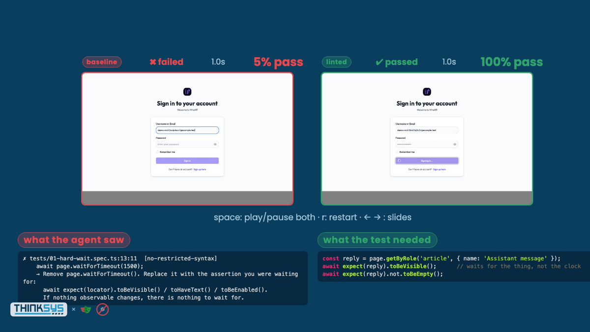

# Stop Reviewing Your Agent's Flaky Playwright Tests

Companion repository for the talk by John Hill ([@unlikelyzero](https://github.com/unlikelyzero)),
maintainer of [eslint-plugin-playwright](https://github.com/playwright-community/eslint-plugin-playwright),
given with [ThinkSys](https://www.thinksys.com).

The claim: a prompt-file rule is a suggestion; an ESLint rule wired into the agent's edit
loop is a verdict. The evidence: the same prompt, written twice by an agent, once with the
rules and once without, then run twenty times each under the same injected flake.

<p align="center">
  
</p>

## Results

20 runs per spec, same seeded flake on both sides. `linted` is the agent's second draft after
the hook fed it the rule message; `baseline` is its first draft with no rules.

| Rule | Shortcut the agent reached for | Injected condition | baseline | linted |
|---|---|---|---:|---:|
| `no-wait-for-timeout` | `waitForTimeout(2000)` | API 300 to 2500 ms late | 5% | 100% |
| `no-force-option` | `click({ force: true })` | banner covers the composer | 0% | 100% |
| `no-nth-methods` | `.first()` to dodge strict mode | decoy send control | 0% | 100% |
| `no-raw-locators` | CSS path copied from a snapshot | classes and ids renamed | 0% | 100% |
| `prefer-web-first-assertions` | `expect(await textContent())` | reply streams in | 55% | 100% |
| `no-conditional-in-test` | `if (await x.isVisible())` | banner lands after the check | 0% | 100% |
| custom `no-page-in-spec` | `page.locator()` hidden in a helper | classes and ids renamed | 0% | 100% |

The deck plays the two recordings side by side for each rule. A PDF of the slides is in
[`stop-reviewing-your-agents-flaky-tests.pdf`](stop-reviewing-your-agents-flaky-tests.pdf).

## What is here

```
eslint.config.mjs      the config from the talk; copy the linted block into your repo
eslint-rules/          no-page-in-spec (closes the helper loophole) and the agent-facing formatter
scripts/lint-hook.sh   PostToolUse hook: lints the file the agent just edited, exit 2 on errors
scripts/ratchet.mjs    bulk-suppression ratchet: init, report (test-side vs app-side), tighten
tests/baseline/        the agent's first drafts, no rules          (control)
tests/linted/          the agent's second drafts, rules + hook     (treatment)
tests/support/         flake seams (flake.ts) and the account helper (account.ts)
flake-lab/             runs each project N times and tallies pass rates into deck/data.json
deck/                  reveal.js slides, vendored; reads deck/data.json and deck/videos/
prompts/               the exact prompts, one per rule
```

## Run it

Requires Docker, Go 1.27+, Node 22+. The target app is
[what-iff](https://github.com/theimaginaryfoundation/what-iff) in mock-LLM mode, so no
provider keys are needed.

```bash
npm install
npx playwright install chromium
npm run prepare:what-iff        # clones ../what-iff, generates Ent code, writes secrets,
                                # starts Postgres + API on :8080 + Angular on :4200
```

In a second shell:

```bash
npm run lint                    # baseline has no rules; linted is clean
npm run lint:agent tests/baseline/01-hard-wait.spec.ts   # what the hook shows the agent
npm run test:showcase           # one slow run of every spec with video
npm run flake-lab -- 20         # 20 runs per spec, both projects; takes a while
npm run deck                    # serves the slides on :8000
npm run deck:pdf                # regenerates the PDF
```

`flake-lab` and `build-deck-data` merge into the existing `deck/data.json`, so one rule can
be re-recorded or re-measured on its own:

```bash
SHOWCASE=1 npx playwright test --workers=1 tests/baseline/03-*.ts tests/linted/03-*.ts
node flake-lab/build-deck-data.mjs
```

## The hook

`.claude/settings.json` runs `scripts/lint-hook.sh` after every `Edit` and `Write`. The script
lints only the touched file, formats the output as instructions, and exits 2. Claude Code
feeds that stderr back to the model as the result of its own edit, so the fix lands before a
browser ever launches. Cursor (`hooks.json`, `afterFileEdit`) and a pre-commit hook for
Copilot run the same script; only the payload parsing differs.

The messages are the point. `eslint-plugin-playwright` says what is wrong;
`eslint.config.mjs` layers `no-restricted-syntax` twins that say what to do instead. An agent
that reads "Unexpected use of page.waitForTimeout()" tries something else at random. One that
reads "Replace it with the assertion you were waiting for: `await expect(locator).toBeVisible()`"
repairs on the first try.

## The flake seams

Every condition is injected from the test side in `tests/support/flake.ts`; what-iff is
untouched and both projects run under identical conditions. A spec opts in with
`test.use({ flake: ['overlay'] })`. `FLAKE=all`, `FLAKE=none`, or `FLAKE=slowApi,overlay`
override from the shell.

| Seam | What it does | What it breaks |
|---|---|---|
| `slowApi` | delays every `/api/` response 300 to 2500 ms, jittered | `waitForTimeout(n)` |
| `overlay` | mounts an announcement dialog 200 to 1200 ms after load, over the composer | `force: true`, `isVisible()` guards |
| `duplicates` | adds a decoy control with the send button's class | `.first()`, class selectors |
| `renameCss` | rewrites `composer__*` and `bubble__*` classes, renames the input id | copied CSS paths |
| `streamText` | re-emits the assistant reply in chunks | `expect(await textContent())` |
| `reorder` | shuffles the thread list | `nth()` on list rows |

The jitter is seeded from `repeatEachIndex`, so run *k* of `baseline` sees the same timing as
run *k* of `linted`.

## Rolling it out: the ratchet

Turn every rule on today; fix nothing today. ESLint 9.24+ bulk suppressions do the work.

```bash
npm run ratchet:init      # eslint --suppress-all, writes eslint-suppressions.json; commit it
npm run ratchet:report    # splits the frozen violations into test-side and app-side
npm run ratchet:tighten   # eslint --prune-suppressions; fails on anything new. Run it in CI.
```

Every rule still runs on every file. ESLint only stays quiet about the counts already in the
file. A new violation is not in it and fails. A fixed one leaves a stale entry that `tighten`
prunes. The number only goes down.

`tests/ratchet-demo/` is a frozen copy of the baseline specs with the linted rules applied:
40 violations in `eslint-suppressions.json`, so the ratchet can be watched working.

### Most of the suppressions are app bugs

`no-raw-locators` firing on `page.locator('#chat-composer-input')` is not a test problem. The
element has no role, no label, no accessible name; a screen reader cannot find it either.
The fix is in the app. `ratchet:report` groups the app-side entries by selector so each one
becomes a ticket: add the label, switch the test to `getByRole('textbox', { name: 'Message' })`,
run `tighten`, and the number drops by however many specs used that selector.

## Deck controls

Arrow keys move between slides. On a comparison slide, space plays and pauses both videos
and `r` restarts them; videos start on slide entry. `s` opens speaker notes.
